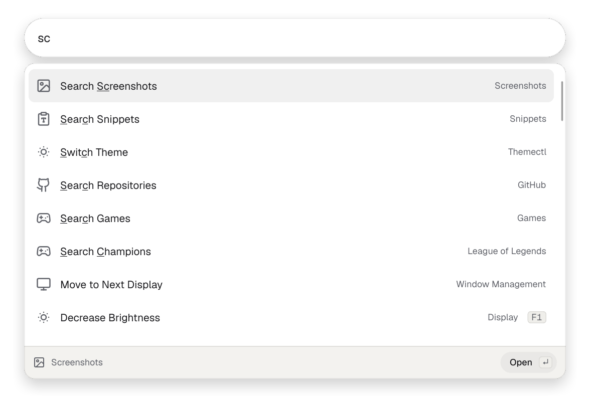
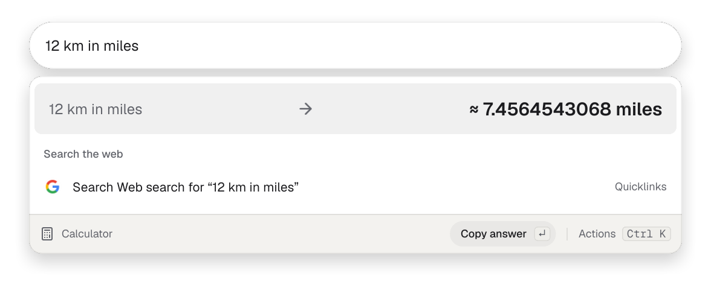
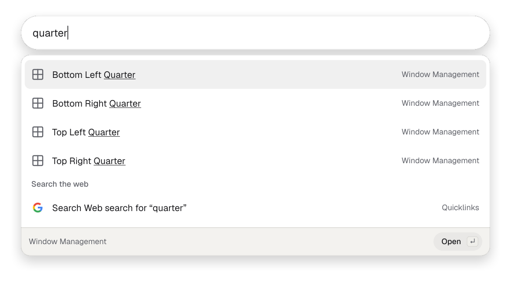

# Dango

A keyboard-first launcher for Windows and macOS.

Dango sits in the tray. Press one shortcut, type a few letters, press Enter.
It is a hobby project that I build for my own daily use.



## What it does

- Open apps and switch to running ones
- Do math and convert units while you type
- Start your Steam games
- Clipboard history, with text, images, and files
- Snippets that expand when you type a keyword
- Quicklinks to sites and web searches
- Move and resize windows
- AI commands for the selected text, such as fix spelling or translate
- Find, copy, and paste your latest screenshots
- System commands: lock, sleep, empty trash
- CapsLock as an extra modifier key
- Your own extensions, written in JavaScript

Every command can have a global hotkey, so it also works without opening the
launcher.

| Answers while you type | Window management |
| --- | --- |
|  |  |

## Install

Download the installer from the
[latest release](https://github.com/Nico-Mayer/dango-launcher/releases/latest).
After that, Dango updates itself.

- **Windows:** run `dango_<version>_x64-setup.exe`. SmartScreen warns on the
  first run. Choose "More info", then "Run anyway".
- **macOS (Apple Silicon):** open `Dango_<version>_aarch64.dmg` and drag Dango
  to Applications. Then run `xattr -cr /Applications/Dango.app` once, or
  macOS blocks the app.

Press `Alt+Space` (`Option+Space` on macOS) to open the launcher.

## Configuration

Dango works without any setup. To change something, run **Open Config File**
from the launcher. It opens `~/.config/dango/config.toml`.

A small example:

```toml
[launcher]
hotkey = "alt+space"
autostart = true

[hyperkey]
enabled = true
tap = "escape"

[applications.hotkeys]
Firefox = { hotkey = "hyper+b" }
code = { name = "Visual Studio Code", hotkey = "hyper+c" }

[window-management.commands]
left-half = { hotkey = "ctrl+alt+left" }
right-half = { hotkey = "ctrl+alt+right" }

[clipboard.commands]
history = { hotkey = "mod+shift+v" }
```

Every setting is listed in [docs/config.md](docs/config.md).

## More

- [All settings](docs/config.md)
- [Development and releases](docs/development.md)

[](https://slint.dev)

The interface is built with [Slint](https://slint.dev) under its royalty-free
license, which asks for the badge above.
